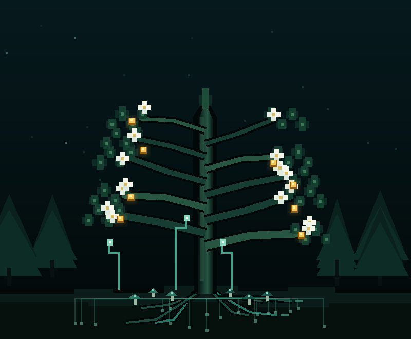

# NOCTIS · Yaşayan Organizma

NOCTIS; çalışma, ibadet, dinlenme, maddi yardım ve disiplin davranışlarını karanlık bir piksel-art organizmanın gelişimine dönüştüren, çevrimdışı çalışabilen kişisel takip PWA prototipidir.



## Görsel gelişim sistemi

- **Dünyevi çalışma:** Gövdeyi, dalları ve yaprakları geliştirir.
- **Dinî çalışma:** Beyaz çiçekler açtırır.
- **Dinlenme:** Kökleri, miselyumu, mantarları ve orman ekolojisini geliştirir.
- **Maddi yardım:** Altın ışıklı meyveler oluşturur.
- **Dengeli faaliyet:** Büyümeyi hızlandırır ve nadir simbiyotik yapılar açar.
- **Disiplin ihlali:** Gövdede kalıcı yara izleri bırakır.

Organizma aynı kayıtlarla her zaman aynı görünür. Ana görsel eşikler 1., 5. ve 15. kayıt günüdür.

## Özellikler

- Kronometre ve elle faaliyet kaydı
- Düzenlenebilir faaliyet katsayıları
- Ödül dakikası ekonomisi
- Organizmaya kalıcı dakika aktarımı
- Maddi yardım kaydı
- Yağmur, orman ve gürültü sesleri
- Beş günlük seri duvar kâğıdı JSON arşivi
- JSON yedekleme ve geri yükleme
- Kayıtları veya bütün verileri kontrollü sıfırlama
- v0.3 yerel verileri ve eski JSON yedekleri için otomatik veri göçü
- Çevrimdışı PWA önbelleği

## Çalıştırma

Basit kullanım için `index.html` dosyasını doğrudan açabilirsiniz.

PWA kurulumu ve çevrimdışı önbellek için klasörü localhost üzerinden çalıştırın:

```bash
python -m http.server 8080
```

Ardından tarayıcıda `http://localhost:8080` adresini açın.

## Veri gizliliği

Bütün kayıtlar kullanıcının tarayıcısındaki yerel depolamada tutulur. Bu prototipte bulut senkronizasyonu veya harici API anahtarı yoktur. Tarayıcı verilerini temizlemeden önce uygulama içinden JSON yedeği alınması önerilir.
